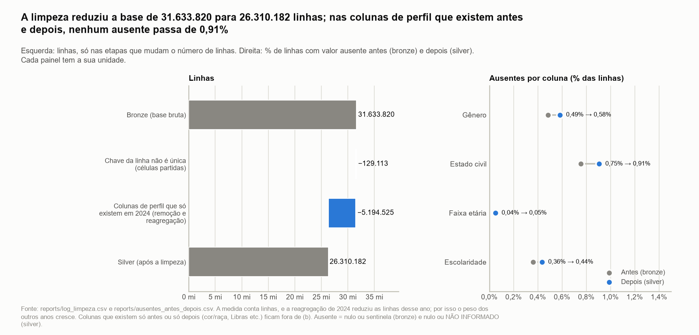
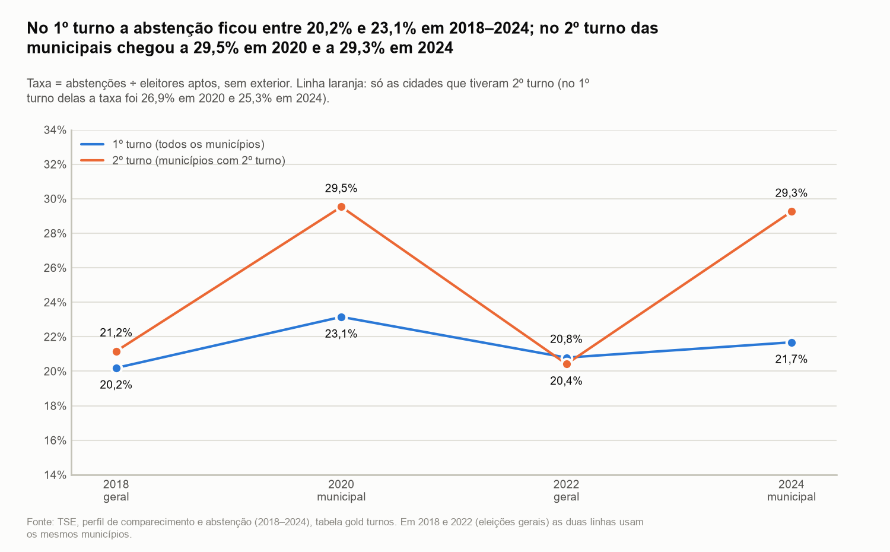
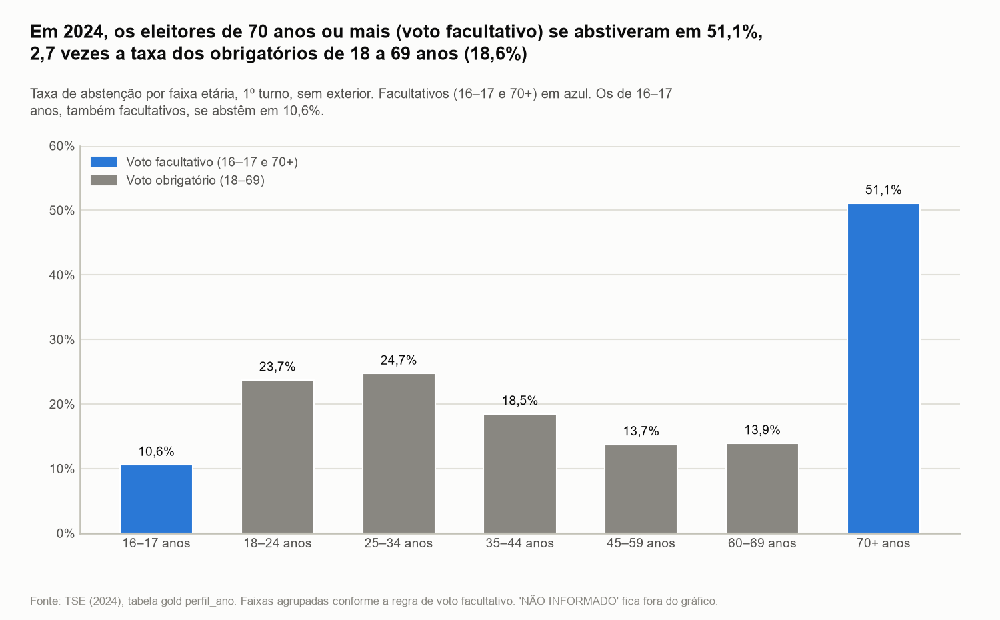
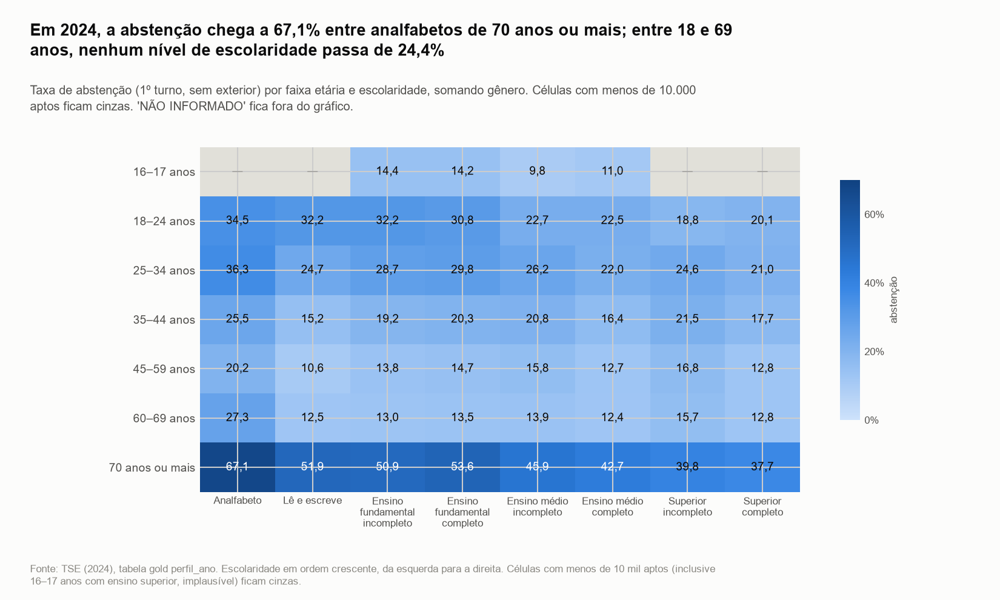
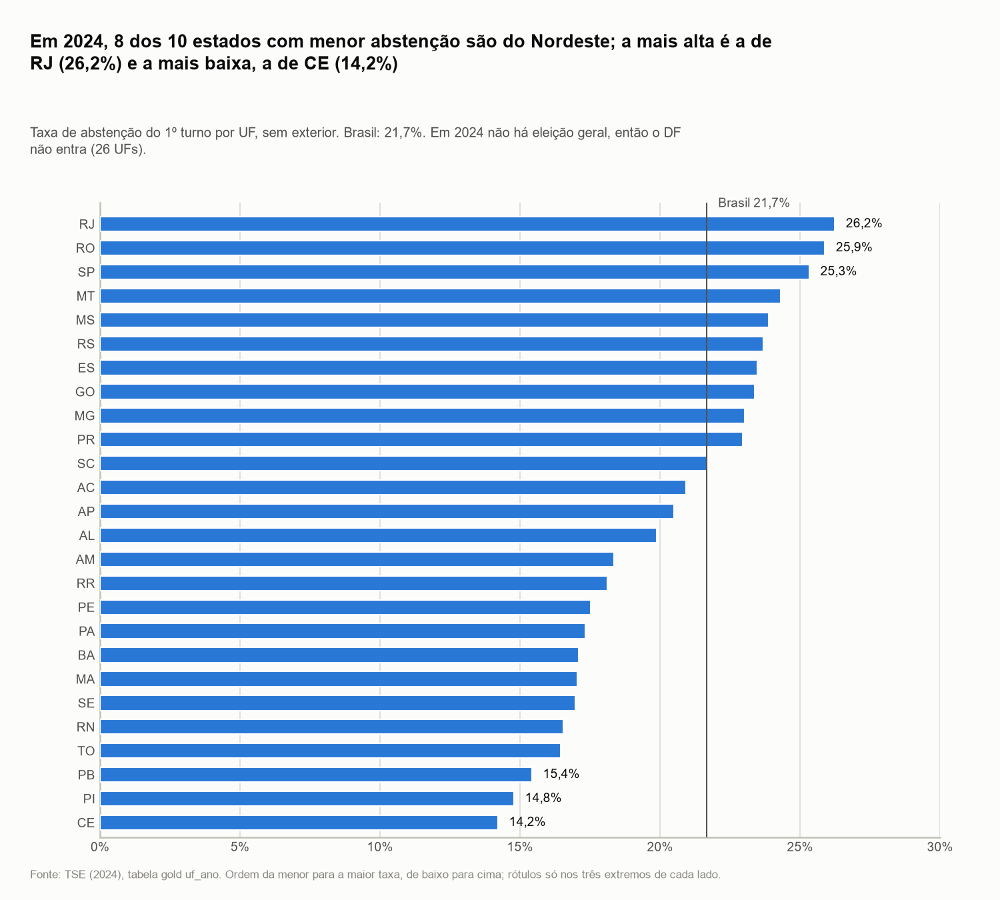
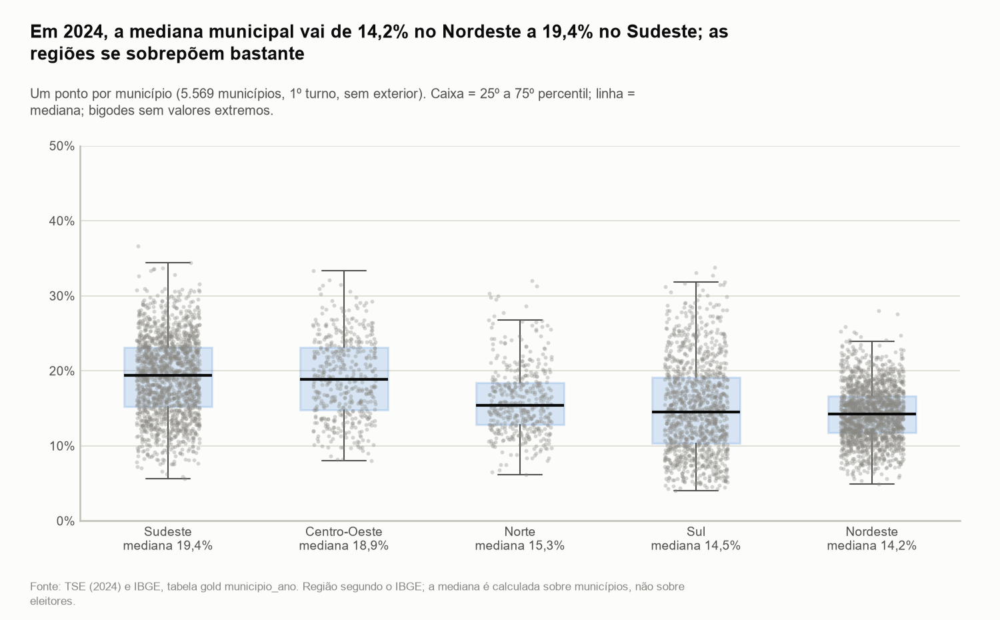
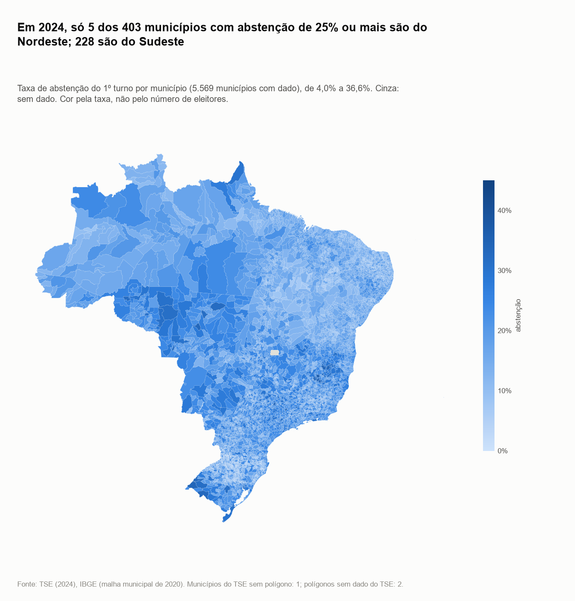
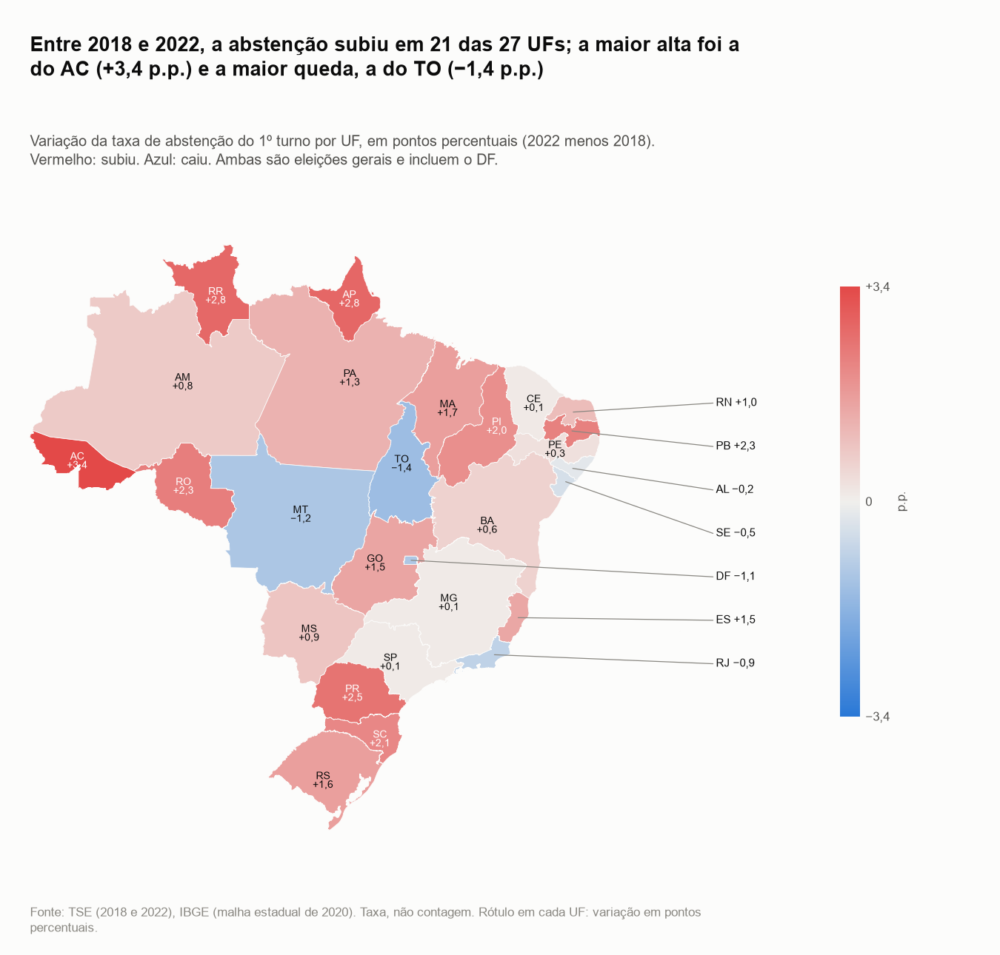
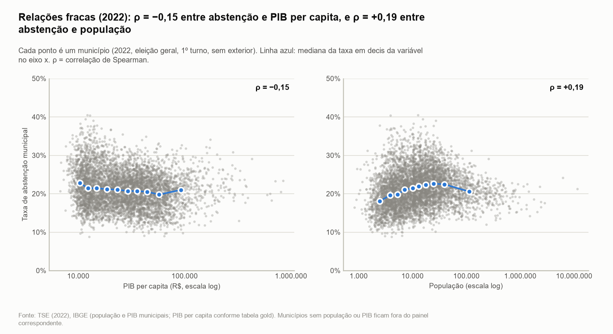

Repositório: <https://github.com/GUSTAVOHOOO/bigdata-tse-abstencao>. O notebook `notebooks/etapa1.ipynb` reproduz todos os números deste relatório.

# 1. Contexto e perguntas

Nas eleições de 2018 a 2024, de cada cinco eleitores aptos, cerca de um não foi votar no 1º turno. O TSE publica, para cada município, zona, turno e perfil do eleitor (gênero, estado civil, faixa etária, escolaridade), quantos estavam aptos, quantos compareceram e quantos se abstiveram. Este trabalho cruza esses dados com população e PIB municipal do IBGE para responder a cinco perguntas, definidas na ficha de proposta:

1. A abstenção cresceu de 2018 a 2024? Como se comparam eleições gerais (2018, 2022) e municipais (2020, 2024), e 1º e 2º turno?
2. Quais faixas etárias se abstêm mais, e quanto pesam os grupos de voto facultativo (16 e 17 anos, 70 ou mais)?
3. Existe gradiente de abstenção por escolaridade?
4. Quais UFs e regiões têm as maiores taxas, e a eleição de 2020 (pandemia) foi um ponto fora da curva?
5. Municípios mais populosos ou com maior PIB per capita se abstêm mais ou menos?

Toda taxa é a razão das somas (abstenções ÷ aptos) dentro de um mesmo turno, sem o exterior, salvo quando dito.

# 2. Fonte e volume

A fonte principal é o conjunto "Perfil de comparecimento e abstenção" do Portal de Dados Abertos do TSE (licença CC-BY), um ZIP por ano. A segunda fonte é o IBGE: população estimada (SIDRA 6579) e do Censo 2022 (SIDRA 4709), PIB municipal (SIDRA 5938) e a lista de municípios da API de localidades. Os códigos de município do TSE não são os do IBGE; a ponte é um de-para mantido por terceiros no GitHub (5.570 pares). A coleta (`src/coleta.py` e `src/ibge.py`) baixa tudo sozinha, repete a requisição até cinco vezes com espera exponencial, descarta ZIPs corrompidos e pula arquivos já baixados. Cada arquivo extraído tem uma linha em `reports/metadados_coleta.csv` (URL, data, linhas, colunas, bytes).

| Ano | Tipo | Arquivos CSV | Linhas | CSV (MB) |
|---|---|---:|---:|---:|
| 2018 | geral | 28 | 8.377.682 | 2.252 |
| 2020 | municipal | 26 | 4.644.923 | 1.250 |
| 2022 | geral | 28 | 8.785.738 | 2.363 |
| 2024 | municipal | 26 | 9.825.477 | 2.446 |
| **Total** | | **108** | **31.633.820** | **8.312** |

**Volume total coletado.** Quatro ZIPs com 666 MB, que se abrem em 108 CSVs de 43 colunas: 31.633.820 linhas e 8.311,75 MB. A base cumpre os requisitos mínimos: mais de 5 milhões de linhas, quatro eleições ao longo de seis anos e integração com o IBGE.

**Redução com Parquet.** A camada bronze em Parquet (zstd, particionado por `ano` e `SG_UF`) ocupa 217,49 MB, 97,4% menos que os CSVs. No maior arquivo (SP 2024, 419 MB), o pandas leva 11,95 s para ler o CSV e 0,53 s para ler o Parquet, cerca de 22 vezes menos; com o leitor do pyarrow, 1,15 s contra 0,54 s (`reports/benchmark_csv_parquet.csv`).

**Dificuldades impostas pela fonte.** O servidor do TSE respondeu sem erro em todas as execuções deste trabalho; se falhar, a coleta repete o pedido. As dificuldades vieram dos próprios arquivos:

- Cada ZIP tem os CSVs por UF e um `*_BRASIL.csv` de cerca de 2,5 GB que repete todas as linhas. DF e exterior (`ZZ`) só existem dentro desse arquivo, porque os arquivos por UF trazem apenas os 26 estados. A coleta lê o `_BRASIL.csv` em fluxo, grava só as UFs que faltam e nunca o salva inteiro.
- Os CSVs vêm em latin-1, com `;` como separador; em 2018 os números vêm sem aspas.
- O layout mudou entre os anos sem mudar o cabeçalho: as seis colunas de cor/raça, quilombola, Libras, identidade de gênero, idioma e grupo indígena existem nos quatro anos, mas só têm valor em 2024 (antes, `-1` em 100% das linhas).
- O eleitorado do 1º turno se repete no 2º, e linhas que parecem duplicadas são pedaços de uma mesma célula, com eleitores reais (seção 3).
- O código de município do TSE não é o do IBGE. O de-para de terceiros não tem Boa Esperança do Norte (MT), criado em 2024; o par 73709 → 5101837 foi acrescentado à mão, conferido pelo nome e pela UF nas duas fontes.
- A população do IBGE muda de fonte em 2022 (Censo no lugar da estimativa) e o PIB de 2024 ainda não existe, então a eleição de 2024 usa o PIB de 2023. A eleição de 2020 foi em novembro, adiada pela Emenda Constitucional 107/2020; as demais foram em outubro.

# 3. Principais problemas de qualidade e decisões

A EDA (seção 2 do notebook) terminou com 13 problemas priorizados. Cada um recebeu uma decisão, registrada com justificativa, viés e efeito medido em `reports/log_limpeza.csv`. A tabela resume o log; "células" quer dizer linhas × colunas examinadas.

| # | Problema | Decisão | Efeito medido |
|---|-----------|-----------|----------|
| 1 | Eleitorado repetido entre turnos | Toda taxa é calculada dentro de um turno; marca `tem_2o_turno` | 18.458.544 linhas marcadas |
| 2 | Chave não única: 1.979 "duplicados exatos" são células partidas | Somar as `qt_*` pela chave completa, sem apagar nada | −129.113 linhas; totais de aptos, comparecimento e abstenção idênticos |
| 3 | Exterior misturado aos municípios (abstenção de 59,1% e 51,7%) | Coluna `exterior`; fica no total nacional e sai das análises por município e UF | 141.100 linhas marcadas |
| 4 | Colunas de perfil só preenchidas em 2024 | `-1` vira nulo; as 12 colunas saem da silver e 2024 é reagregado | 166.443.438 células anuladas; −5.194.525 linhas |
| 5 | Sentinelas (código `0`, faixa `-3`) | Nulo no código e rótulo NÃO INFORMADO; ficam nos totais, saem das análises por perfil | 520.652 células (no máximo 0,065% dos aptos) |
| 6 | Abstenção de 88% a 99% acima de 90 anos | Manter; criar `grupo_idade` e `faixa_etaria_agrupada` | 1.283.032 linhas de 90+ identificadas, nenhum valor alterado |
| 7 | Município sem par no de-para | Acrescentar 73709 → 5101837 | 509 linhas casadas; as 141.100 sem código IBGE são todas do exterior |
| 8 | Todas as colunas em texto | snake_case e tipos do dicionário | 0 linhas; memória estimada de 85,6 GB para 9,0 GB |
| 9 | Falta o tipo de eleição; colunas redundantes | Derivar `tipo_eleicao`; tirar `ano_eleicao`, data e hora de geração | 0 linhas |
| 10 | Rótulos com caixa inconsistente | Maiúsculas, sem espaços extras; junções só por código | 42.744.791 células |
| 11 | Municípios com abstenção extrema | Manter (são casos reais); marca `outlier_iqr` na gold | 21, 4, 63 e 22 municípios marcados |
| 12 | 16 ou 17 anos com superior completo | Marca `perfil_implausivel`, sem corrigir | 1.605 linhas |
| 13 | Variáveis do IBGE de fontes e anos diferentes | Guardar `fonte_populacao` e `ano_pib`; Spearman e log10 nas correlações | 13.241.008 linhas com Censo ou PIB de outro ano |

As derivações pedidas também estão no log: `data_turno` e `mes_ano`, `voto_facultativo` (nulo em 59.320 linhas, em que idade ou escolaridade é desconhecida), região e, na gold, abstenções por 100 mil habitantes. Nenhuma linha viola aptos = comparecimento + abstenção. Duas decisões introduzem viés. Os eleitores sem gênero, estado civil ou escolaridade se abstêm de 41% a 59%, então as taxas por perfil ficam até 0,02 ponto abaixo da taxa geral. Só 10,2% dos aptos de 2024 declararam cor/raça, e esse grupo se abstém menos (16,6% contra 22,3%), por isso cor/raça ficou fora das perguntas.

A silver (`data/silver/tse/`, Parquet particionado por ano e UF) tem 26.310.182 linhas e 46 colunas tipadas, 16,8% menos linhas que a bronze, e ocupa 197 MB. Quase toda a redução vem de 2024. A gold (`data/gold/`) tem quatro tabelas agregadas (município, UF, perfil e turnos), com 1,9 MB.

{width=100%}

# 4. Resultados

As nove figuras estão em `reports/figuras/`; os nomes dos arquivos seguem a numeração do notebook, e a deste relatório segue a ordem de leitura. O título de cada figura é a conclusão que ela mostra, calculada a partir da gold.

**P1. Evolução, tipo de eleição e turno.** A abstenção não cresceu de forma contínua. No 1º turno foi de 20,2% (2018), 23,1% (2020), 20,8% (2022) e 21,7% (2024): as municipais ficam acima das gerais. Nas gerais, o 2º turno repete o eleitorado e a taxa quase não muda (21,2% e 20,4%). Nas municipais, só cidades com mais de 200 mil eleitores votam de novo; nelas o 2º turno chegou a 29,5% (2020) e 29,3% (2024), contra 26,9% e 25,3% no 1º turno das mesmas cidades.

{width=95%}

**P2. Idade e voto facultativo.** A taxa tem forma de U. Em 2024, foi de 10,6% entre 16 e 17 anos, 24,7% entre 25 e 34, 13,7% entre 45 e 59 e 51,1% aos 70 ou mais, 2,7 vezes a dos obrigatórios de 18 a 69 anos (18,6%). Entre os de 70 ou mais, a taxa caiu de 62,7% (2018) para 51,1% (2024), passando por 64,0% em 2020 e 58,8% em 2022. Os facultativos (16 e 17 anos, 70 ou mais, analfabetos) são 12% a 13% dos aptos e respondem por 26% a 32% de toda a abstenção. O peso vem dos idosos, porque os jovens de 16 e 17 anos votam mais que a média.

{width=95%}

**P3. Escolaridade.** Há gradiente, mais forte nas eleições gerais: em 2022, de 52,1% entre analfabetos a 11,9% no superior completo. Nas municipais ele achata no topo (2024: 40,4% contra 17,7%), e o superior incompleto (21,7%) passa do médio completo (18,6%). Parte do gradiente vem da idade, já que os analfabetos são mais velhos: entre 18 e 69 anos, em 2024, nenhum nível passa de 24,4% (analfabetos), e entre os de 70 ou mais os analfabetos chegam a 67,1%.

{width=95%}

**P4. UFs, regiões e 2020.** O Sudeste tem a maior taxa nos quatro anos (22,0% a 26,3%). A menor é a do Sul nas gerais (17,3% e 19,3%) e a do Nordeste nas municipais (18,5% e 16,5%). Em 2024, a mais alta foi a do RJ (26,2%) e a mais baixa a do CE (14,2%); 8 das 10 UFs com menor abstenção são do Nordeste. Por município, a mediana de 2024 vai de 14,2% no Nordeste a 19,4% no Sudeste, com muita sobreposição entre regiões. Dos 403 municípios com 25% ou mais, 228 são do Sudeste e 5 do Nordeste. Entre as duas eleições gerais, a taxa subiu em 21 das 27 UFs, de +3,4 pontos no AC a −1,4 no TO. Em 2020, a taxa ficou acima da média dos outros anos em 20 das 26 UFs, mas a maior parte dessa alta acompanha o tipo de eleição: contra a outra municipal, a diferença no país é de 1,4 ponto (23,1% em 2020 e 21,7% em 2024). Esse 1,4 ponto pode refletir a pandemia, mas esta análise não consegue isolar esse efeito.

{width=62%}

{width=95%}

{width=72%}

{width=72%}

**P5. População e PIB.** A população é a variável do IBGE mais associada à abstenção, e só nas municipais: o Spearman é 0,65 (2020) e 0,59 (2024), contra 0,16 (2018) e 0,19 (2022). Na Figura 9 (2022), a mediana sobe com a população até algumas dezenas de milhares de habitantes e cai nas cidades maiores. O PIB per capita tem relação fraca e de sinal instável (−0,17, 0,10, −0,15 e 0,20).

{width=100%}

# 5. Limitações

- Taxas de 88% a 99% acima de 90 anos sugerem que o cadastro mantém como aptos eleitores que morreram ou não podem mais votar. A hipótese não foi testada contra óbitos ou população por idade; se for verdadeira, a taxa dos 70 ou mais e a de municípios com população idosa estão superestimadas.
- A ponte TSE → IBGE vem de um repositório no GitHub, sem licença confirmada, e um par foi acrescentado à mão.
- A série de população tem uma quebra: 2022 usa o Censo e os outros anos usam a estimativa; 2024 usa o PIB de 2023.
- As correlações com população e PIB são entre municípios (falácia ecológica): não dizem nada sobre o comportamento de cada eleitor, e as variáveis explicativas se correlacionam entre si (PIB per capita × superior completo: 0,60 em 2022).
- Cor/raça e as demais colunas novas não têm série e cobrem cerca de 10% dos aptos; a silver não permite essas análises.
- A série tem quatro pontos (uma eleição a cada dois anos, alternando o tipo), o que não permite separar tendência, tipo de eleição e choques como a pandemia.
- O pipeline completo, com os quatro anos, rodou na cópia de trabalho. Num clone limpo do repositório, os passos do README foram repetidos só para 2024: coleta, IBGE, silver e gold reproduziram as mesmas 9.825.477 linhas brutas e 4.590.377 linhas tratadas, e os 52 testes passaram. As figuras exigem os quatro anos e não foram refeitas no clone.

# 6. Próximos passos para a Parte 2

- Modelo de regressão da taxa municipal (beta ou logística agregada, ponderada pelos aptos) com população, PIB per capita, composição etária e escolar do eleitorado, região e tipo de eleição, para separar o que as correlações misturam.
- Estimar o efeito do voto facultativo comparando os 17 e os 18 anos e os 69 e os 70 anos, idades vizinhas em lados opostos da regra (desenho de descontinuidade).
- Alongar a série com 2014 e 2016, que o TSE publica no mesmo formato, para ter três eleições de cada tipo e separar a pandemia do tipo de eleição.
- Testar a hipótese do cadastro desatualizado com a população do Censo 2022 por idade e município.
